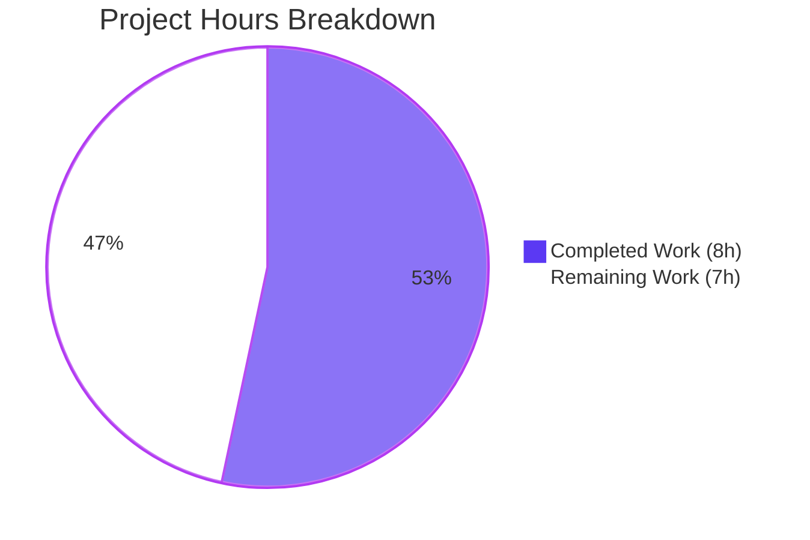

# 1. Executive Summary

## 1.1 Project Overview

`hao-backprop-test` is a single-file Node.js HTTP service used as an integration sample. This change moves it onto Express 5.3.0 and adds a second route: `GET /good-evening` answers `200` with a 13-byte `Good evening\n` body, while the existing `GET /` keeps returning its 14-byte `Hello, World!\n` byte for byte. Scope is two files — `server.js` and `package.json` — with no new module, test, documentation or configuration, and an unchanged launch contract on `127.0.0.1:3000`.

## 1.2 Completion Status


| Metric | Value |
|---|---|
| Total Hours | 15.0 |
| Completed Hours (Baseline: Human with agentic-assist) | 8.0 |
| Remaining Hours | 7.0 |
| AAP-Scoped Completion | 53.3% (8.0 ÷ 15.0) |

Every requirement this change was scoped against is delivered and verified. The remaining 7.0 hours are path-to-production work: pinning, a release gate, bind-failure signalling, the package entry point and hygiene.

## 1.3 Key Accomplishments

- [x] `GET /good-evening` serves `200`, `text/plain`, the 13-byte `Good evening\n` — byte-exact on the wire and in a browser.
- [x] `GET /` still serves `200`, `text/plain`, the 14-byte `Hello, World!\n`, identical to the pre-change handler.
- [x] Express 5.3.0 is the only dependency and genuinely serves both paths.
- [x] Media type written explicitly, so neither response carries a charset parameter.
- [x] Launch contract intact: same literals, same readiness line, one listener, clean teardown.
- [x] Framework defaults verified for nine unnamed-input cases, from unknown paths to `OPTIONS`.
- [x] Two files changed (11 insertions, 9 deletions); `package-lock.json` and `README.md` byte-identical.
- [x] Both routes render as plain text in a real client, with no markup or page script.

## 1.4 Critical Unresolved Issues

Open items: **0 of 4** requested requirements remain open; **5 of 5** path-to-production items remain open.

| Issue | Impact | Owner | ETA |
|---|---|---|---|
| Tracked lockfile carries no `express` entry, so `npm ci` fails and installs resolve any `5.x` with no integrity pin | Release pipeline cannot build reproducibly | Build/release owner | 2h |
| No automated regression suite; `npm test` echoes an error and exits 1 | The byte-exact contract is protected by inspection only | Service owner | 3h |
| A start on an already-bound port prints the readiness line and exits 0 without binding | A supervisor can conclude the service is healthy when it is not listening | Operations owner | 1h |
| `package.json` `main` names an absent `index.js`, so `node .` fails `MODULE_NOT_FOUND` | Tooling that resolves the package entry fails | Service owner | 0.5h |
| No `.gitignore`, so an install leaves 65 packages untracked in `node_modules/` | A broad `git add` could stage install artefacts | Repository owner | 0.5h |

Designed absences — `X-Powered-By` disclosure, no charset, no security headers, CORS, authentication, logging or health endpoint — are accepted caveats in Section 6, becoming work only beyond loopback.

## 1.5 Access Issues

No access issues identified: the dependency installs from the public npm registry, the service needs no credentials or external service, and every step ran without elevated access.

## 1.6 Recommended Next Steps

1. **[High]** Pin `express` and its tree in `package-lock.json` so `npm ci` succeeds.
2. **[High]** Add a route-contract suite and wire it to `npm test` so either body change fails.
3. **[Medium]** Report bind failures, exit non-zero, print readiness only after a successful listen.
4. **[Medium]** Point `main` at `server.js` and add a `.gitignore` for install artefacts.
5. **[Low]** Settle the exposure posture — TLS, security headers, charset, `X-Powered-By`, logging, health — before any non-loopback deployment.

# 2. Project Hours Breakdown

## 2.1 Completed Work Detail

| Component | Hours | Description |
|---|---|---|
| Route contract: `GET /good-evening` added, `GET /` preserved (R3, R4) | 2.0 | Two inline registrations in `server.js:8-9`, each one statement, emitting `200`, `text/plain` with no charset, and the 13- and 14-byte bodies |
| Express adoption, dependency declaration and install discipline (R2) | 2.0 | Core `http` server construction replaced by an Express application; `express` declared as the sole dependency in `package.json:11-13` and installed without disturbing the tracked lockfile |
| Launch contract preserved (R2, launch) | 0.5 | The same `127.0.0.1` / `3000` constants and the same readiness line moved onto `app.listen` in `server.js:3-4,11-13` |
| Contract verification and edge-case exercise (R3, R4, framework defaults) | 3.0 | Byte-exact bodies, header fidelity, framework defaults, browser rendering, bind scope and teardown exercised end to end |
| Change-set containment and frozen-artefact discipline (R1, constraints) | 0.5 | Two-file diff only; `package-lock.json` and `README.md` byte-identical; no test, documentation or configuration churn |
| **Total** | **8.0** | |

## 2.2 Remaining Work Detail

| Category | Hours | Priority |
|---|---|---|
| Dependency pinning and reproducible install: write `express` and its tree into the tracked `package-lock.json` with integrity hashes so `npm ci` works and resolution stops drifting across `5.x` | 2.0 | High |
| Automated route-contract regression suite and release gate: assert status, exact media type and exact bytes for both paths, plus a boot smoke, and replace the placeholder `npm test` | 3.0 | High |
| Startup failure signalling and readiness correctness: report a bind failure, exit non-zero, print the readiness line only after a successful listen | 1.0 | Medium |
| Package entry point resolution: `main` names an absent `index.js`, so `node .` fails — point it at `server.js` or remove the field | 0.5 | Medium |
| Repository hygiene: add a `.gitignore` so the untracked `node_modules/` cannot be staged | 0.5 | Medium |
| **Total** | **7.0** | |

Each line is path-to-production work; no requirement of the change itself is outstanding.

## 2.3 Hours Reconciliation

Completed 8.0h plus remaining 7.0h gives 15.0h total. AAP-scoped completion is `8.0 ÷ (8.0 + 7.0) = 53.3%`. The three figures are the same ones stated in Section 1.2, plotted in Section 7 and referenced in Section 8. Of the 15.0h, 8.0h of delivered and verified capability is done and every hour still owed sits in the five path-to-production categories above.

# 3. Test Results

Every count below was produced by running the check against the delivered tree and the live service on this host (Node.js v22.23.5, npm 11.21.3, `express` 5.3.0). The project has no coverage instrumentation, so the Coverage column states what exists rather than an estimate.

| Area / Category | Framework | Tests | Passed | Failed | Coverage | What This Proves |
|---|---|---|---|---|---|---|
| Static syntax gate | `node --check server.js` | 1 | 1 | 0 | n/a | `server.js` parses as valid CommonJS with no syntax fault |
| Route contract and framework defaults | Node `http` client with assertions | 26 | 26 | 0 | n/a | Both routes emit the exact status, media type and body bytes, and nine unnamed-input cases fall through to Express's own defaults |
| Browser rendering | headless Chrome over the DevTools protocol | 5 | 5 | 0 | n/a | Both bodies reach a real client as `text/plain` with the exact byte counts, no markup, no subresource and no page script |
| Process lifecycle and bind scope | shell probes (`net`, `/proc/net/tcp`, signals) | 7 | 7 | 0 | n/a | One loopback listener, one readiness line, SIGTERM teardown, and the duplicate-start behaviour of an occupied port |
| Automated regression suite | none configured — `npm test` is a placeholder | 0 | 0 | 0 | none | No automated suite exists; `npm test` only echoes an error and exits 1 |
| **Total observed** | | **39** | **39** | **0** | | |

What the rows established, in the reader's terms:

- `GET /` answered `HTTP/1.1 200 OK`, `Content-Type: text/plain` (zero charset occurrences in the raw header block), `Content-Length: 14`, and 14 body bytes whose SHA-256 equals that of `printf 'Hello, World!\n'`.
- `GET /good-evening` answered `200`, the same media type, `Content-Length: 13`, and 13 body bytes equal to `printf 'Good evening\n'`, with exactly one trailing LF and no CR.
- Unnamed inputs behaved as the framework decides: `/nope`, `/server.js` and `/api/good-evening` returned the default 404 page, `POST /good-evening` 404, `HEAD /good-evening` 200 with an empty body, `OPTIONS /` 200 advertising `GET`, `/good-evening/` and `/GOOD-EVENING` 200 with the contract bytes, and a query string changed nothing.
- `Authorization` and `Cookie` headers left both responses byte-identical, so no credential is read.

**Not Covered** — what no test in this project exercises, and what a human should establish before release:

- **Anything automatic.** No suite, runner or CI gate exists; every check above was run by hand, so a future edit to either body literal is caught by nobody.
- **Concurrency and load.** No burst, soak, latency or throughput measurement was performed; the service was exercised sequentially plus a small parallel browser and fetch set.
- **Non-loopback deployment.** TLS termination, proxy headers, container networking and service-manager restart behaviour cannot be exercised while the bind is a loopback literal.
- **Non-ASCII bodies.** Both bodies are ASCII, so the consequence of sending `text/plain` without a charset parameter (browsers fall back to `windows-1252`) is unexercised.
- **Dependency provenance.** No advisory or vulnerability status for the resolved `express` version is established anywhere in the project.
- **Hostile-input and access-control matrices.** These are outside this project's scope and no such matrix was run; the handlers read no request data, so the surface a matrix would attack does not exist yet.

# 4. Runtime Validation & UI Verification

Every line below was driven against the running service on `127.0.0.1:3000` and observed, not inferred.

- ✅ **Startup** — `node server.js` prints exactly `Server running at http://127.0.0.1:3000/` once and serves both routes; the log stayed at one line after forty requests.
- ✅ **`GET /good-evening`** — `200`, `Content-Type: text/plain`, `Content-Length: 13`, 13 bytes matching the literal digest, and the browser renders the single line `Good evening`.
- ✅ **`GET /`** — `200`, `text/plain`, `Content-Length: 14`, 14 bytes matching the literal digest, and the browser renders `Hello, World!`.
- ✅ **Unnamed inputs** — `/nope`, `/server.js` and `/api/good-evening` return the framework's 404 page; `POST /good-evening` 404; `HEAD /good-evening` 200 with an empty body; `OPTIONS /` 200 advertising `GET, HEAD`.
- ✅ **Client rendering** — both documents arrive as `text/plain` with zero scripts, zero stylesheets and no request beyond the document and Chrome's own `/favicon.ico` probe; the only console entry on a route load is that probe's 404.
- ✅ **Bind scope** — exactly one `LISTEN` on `127.0.0.1:3000`; a connect to the host's own address `172.17.0.2:3000` is refused, so the service is not reachable off loopback.
- ✅ **Teardown** — `SIGTERM` to the process that owns the port ends it with status 143, releases the port and prints nothing; no shutdown handler exists by design.
- ⚠ **Duplicate start** — a second `node server.js` while the port is held prints the readiness line and exits 0 without binding, while the first instance keeps serving. The readiness line alone is therefore not proof of a live listener.
- ⚠ **`node .`** — fails with `MODULE_NOT_FOUND` because `main` names an absent `index.js`; the service starts with `node server.js`.

No route, method, path variant or lifecycle step produced a 5xx, a hang or a wrong byte count.

**Never exercised at runtime:** there is no external integration, database, queue or third-party API in this service, so none was driven. No container, service manager, reverse proxy, TLS terminator or off-loopback exposure was run, and no non-ASCII body was ever served, so the charset question and every deployment-shape question remain unexercised. There is no user interface beyond the two plain-text documents, so no screen, form or multi-step journey exists to verify.

# 5. Compliance & Quality Review

## 5.1 Compliance Matrix

| # | Deliverable | Benchmark | Status | Progress |
|---|---|---|---|---|
| 1 | Application change confined to `server.js`, no source file created | Change-set discipline | ✅ Pass | 100% |
| 2 | `express` the sole dependency, declared and genuinely serving | Dependency discipline | ✅ Pass | 100% |
| 3 | `GET /good-evening` → 200, `text/plain`, 13-byte `Good evening\n` | Route contract fidelity | ✅ Pass | 100% |
| 4 | `GET /` unchanged → 200, `text/plain`, 14-byte `Hello, World!\n` | Behaviour preservation | ✅ Pass | 100% |
| 5 | Media type written explicitly, no charset parameter on either route | Header fidelity | ✅ Pass | 100% |
| 6 | Launch contract: same constants, same readiness line, one listener | Startup contract | ✅ Pass | 100% |
| 7 | Manifest gains only `dependencies`; pre-existing fields intact | Minimal-diff discipline | ✅ Pass | 100% |
| 8 | Tracked lockfile byte-identical; no lockfile created or committed | Frozen-artefact integrity | ⚠ Pass with caveat — reproducible installs are not available until the lockfile is refreshed | 100% of the change, 0% of the pinning task |
| 9 | `README.md` byte-identical; no `.gitignore` or documentation change | Frozen-artefact integrity | ✅ Pass | 100% |
| 10 | No test suite, test file, tooling, hardening, CORS, logging or environment configuration added | Scope adherence | ✅ Pass | 100% |
| 11 | `server.js` matches the prescribed 13-line shape; no helper, export or extra statement | Prescribed code shape | ✅ Pass | 100% |
| 12 | No request value reaches any sink; no secret, key or outbound call | Static security posture | ✅ Pass | 100% |

## 5.2 AAP & Rule Divergences and Gaps

**No divergences from the Agent Action Plan or user rules were identified.**

The basis: all four requested requirements are satisfied exactly as written — the two route contracts at `server.js:8-9` produce the specified status, media type and body bytes; `express` is the sole dependency at `package.json:11-13` and genuinely serves both paths; the launch contract at `server.js:3-4,11-13` is character-for-character the pre-change one; and the change set is exactly the two mapped files with `package-lock.json` and `README.md` byte-identical. Every excluded item is absent from the tree, which was checked construct by construct (`app.use`, `app.disable`, `process.env`, router, exports, conditionals and every hardening header all zero). The four user rules are administrative records of rule creation, sharing and role-based editing; they name no coding standard, file constraint, pattern, command or test obligation, so no code could honour or violate them, and none was written on their behalf.

Two byte-level items were examined against the requirement wording and found compliant rather than divergent:

| Item examined | What the requirement says | Finding |
|---|---|---|
| `package.json` gains a terminal newline at end of file | Every pre-existing field must stay byte-identical; the manifest must carry the dependency in the form the mandated install writes it | The seven pre-existing field values are unchanged and in order; the newline is the install command's own write, which the requirement mandates rather than forbids |
| `dependencies.express` is `^5.3.0` rather than a literal `^5` | The dependency must appear as a caret range over major 5 in the form the install produced, with no hand-edited version | `^5.3.0` is exactly that range; writing `^5` by hand would have broken the requirement |
| User rules not implemented as features | The rules are records of creation, sharing and role-based editing | No obligation exists to implement, so their absence is compliance, not a gap |

The consequences a reader should still plan for are not divergences but the deliberate decisions this change rests on: the tracked lockfile stays empty of dependencies, which makes `npm ci` fail (Section 2.2, first line, and Section 6); no test suite or release gate exists; and the hardening layers are absent. Each is carried as remaining work or as an accepted risk, with its impact stated.

# 6. Risk Assessment

These are forward-looking: what could still go wrong once this code is in a pipeline or in front of a caller, and how each is contained.

| Risk | Category | Severity | Probability | Mitigation | Status |
|---|---|---|---|---|---|
| `npm ci` cannot build the project: it exits 1 with `Missing: express@5.3.0 from lock file`, so any pipeline built on lockfile installs fails | Operational | High | High | Write `express` and its tree into the tracked `package-lock.json` with integrity hashes (Section 2.2, line 1) | Open |
| A start on an already-held port prints the readiness line and exits 0 without binding, so a supervisor concludes the service is healthy when it is not listening | Operational | High | Medium | Report the bind error, exit non-zero, print readiness only after a successful listen (Section 2.2, line 3) | Open |
| No automated regression suite: the byte-exact contract and the preserved `/` response are protected by inspection only, so a future edit drifts silently | Technical | Medium | High | Add the route-contract suite and wire it to `npm test` (Section 2.2, line 2) | Open |
| Unpinned caret resolution: each install takes whatever `5.x` the registry serves, with no integrity record in the repository and no advisory verification anywhere | Security | Medium | Medium | Pin the tree in the lockfile and run an advisory audit in the release pipeline | Open |
| A fresh checkout ships without `node_modules/`, so the service cannot boot until an install runs | Operational | Medium | High | Documented install step (Section 9); keep install artefacts untracked and out of version control | Open — contained by the documented install |
| Both responses disclose `X-Powered-By: Express`, and no security header, CORS policy, authentication, request logging or health endpoint exists | Security | Low | Low | Acceptable while the bind is loopback-only; a separately scoped hardening change before any non-loopback exposure | Accepted by design |
| `package.json` `main` names an absent `index.js`, so `node .`, `npm start` conventions and any consumer resolving the package entry fail | Integration | Medium | Low | Point `main` at `server.js` or remove the field (Section 2.2, line 4) | Open |
| `text/plain` with no charset parameter makes browsers decode these documents as `windows-1252`; harmless for the two ASCII bodies and a mojibake risk the day a non-ASCII body is added | Technical | Low | Low | Declare the charset if a non-ASCII body is ever introduced | Accepted by design |

# 7. Visual Project Status



How the 7.0 remaining hours are distributed, and what carries the higher risk:

| Remaining category | Hours | Priority | Share of remaining |
|---|---|---|---|
| Dependency pinning and reproducible install | 2.0 | High | 28.6% |
| Automated route-contract regression suite and release gate | 3.0 | High | 42.9% |
| Startup failure signalling and readiness correctness | 1.0 | Medium | 14.3% |
| Package entry point resolution | 0.5 | Medium | 7.1% |
| Repository hygiene (`.gitignore`) | 0.5 | Medium | 7.1% |
| **Total remaining** | **7.0** | | **100%** |

The two High-priority categories carry 5.0h of the 7.0h and both sit on the release path: without a pinned lockfile no lockfile-driven build succeeds, and without a suite no future change is checked. The three Medium items are small, independent and can land in any order. The 8.0h of completed work is entirely delivered capability — the two route contracts, the dependency and its install discipline, the launch contract, the verification that proves them and the containment that keeps the change set to two files.

# 8. Summary & Recommendations

**What is delivered.** The service now runs on Express 5.3.0 and answers two routes exactly. `GET /good-evening` returns `HTTP/1.1 200 OK`, `Content-Type: text/plain` with no charset parameter, and the 13-byte body `Good evening\n`; `GET /` returns the same status and media type with the 14-byte body `Hello, World!\n`, byte-identical to the handler it replaced at commit `a40c571`. `express` is the only dependency declared (`package.json:11-13`) and the only one serving traffic. The listener keeps the same `127.0.0.1` and `3000` constants and the same readiness line (`server.js:3-4,11-13`). The change is two files, 11 insertions and 9 deletions, with `package-lock.json` and `README.md` byte-identical and nothing created, deleted or renamed.

**What was verified.** 39 checks were executed against the delivered code and the live service: a syntax gate, a 26-assertion contract harness covering both routes and nine framework-default cases, a five-step browser walkthrough that confirmed the exact bytes render as plain text with no markup or page script, and seven lifecycle probes covering the single loopback listener, the readiness line, `SIGTERM` teardown and the occupied-port behaviour. All 39 passed. Section 3 states plainly what no test covers: there is no automated suite, no load measurement, no non-loopback deployment exercise and no non-ASCII body.

**Where the project stands.** Completion is **53.3%** — 8.0h of 15.0h — and that figure deserves a plain reading: every requirement the change was scoped against is closed (0 of 4 open), and the 7.0h still owed is entirely path-to-production work around the code rather than in it. The two heaviest items are a pinning change that makes the install reproducible (2.0h) and a route-contract suite wired to a real gate (3.0h); together they carry 5.0h and 43% of the remaining total.

**Critical path.** Pin the dependency first — nothing downstream can be validated reproducibly while `npm ci` exits 1 with `Missing: express@5.3.0 from lock file`. Then land the suite and the gate, which is what turns the two byte-exact contracts into something a future change cannot break silently. The three Medium items — bind-failure signalling, the `main` entry point and a `.gitignore` — are half-hour to one-hour changes and can be done in parallel by whoever holds the repository. Success looks like: `npm ci` succeeding on a clean clone, a suite that fails when either body literal is edited, a non-zero exit when the port is held, and a clean `git status` after an install.

**Production readiness.** Ready for what it is — a loopback-bound, two-route plain-text sample with a fixed launch contract, now on a maintained framework. Not ready for a lockfile-driven pipeline, and not hardened: `X-Powered-By` is disclosed, no security header, CORS policy, authentication, request logging or health endpoint exists, and the advisory status of the resolved `express` version is unestablished. Those absences are correct for the agreed scope and become a separately scoped hardening change the moment the service is exposed beyond loopback.

# 9. Development Guide

## 9.1 System Prerequisites

- **Node.js 22.23.5 or later within the 22.x line.** Verified on `v22.23.5`. Express 5 declares `node >= 18`; the manifest carries no `engines` field, so an older runtime fails at start-up rather than at install time.
- **npm 11.21.3** (verified), plus `npx` and `corepack` if you want them.
- **No database, message broker, external service, environment variable or secret.** Both responses are compiled-in literals; the host and port are literals at `server.js:3-4`.
- Linux shell with `curl`; `ss`, `netstat` and `lsof` are not required (the port probe below uses Node instead).

## 9.2 Environment Setup and Dependency Installation

All commands run from the repository root. Node has no virtual environment: the checkout-local `node_modules/` is the environment.

```bash
cd /path/to/repository          # the checkout that contains server.js and package.json
node --version                   # expect v22.23.5 (or another 22.x >= 22.12.0)
npm --version                    # expect 11.21.3
```

Install the dependency exactly as the delivered state requires — the tracked `package-lock.json` must stay byte-identical, so the install must not write it:

```bash
CI=true npm install express@5 --no-package-lock --no-audit --no-fund --prefer-offline
```

Expected: `added 65 packages` (or `changed 65 packages` on a warm cache) and exit 0. Confirm both the install and the frozen lockfile:

```bash
node -e "console.log(require('express/package.json').version)"   # expect 5.3.0
npm ls --depth=0                                                  # expect └── express@5.3.0
sha256sum package-lock.json    # expect 46f7913cb1848efd80561b7957eb6dcb9a182c190a31d3c81108fb2ca1454612
git status --porcelain         # expect only: ?? node_modules/
```

Two cautions. Never run a bare `npm install` with no arguments — it prunes the unlisted `express` from `node_modules/`. And if you *want* a reproducible, `npm ci`-compatible install, that is a different, deliberate change: `npm install express@5` (without `--no-package-lock`) rewrites `package-lock.json`, which is the dependency-pinning task in Section 2.2, not a setup step.

## 9.3 Application Startup

```bash
node --check server.js          # syntax gate; expect exit 0 and no output
node server.js                  # starts the service in the foreground
```

Expected output, exactly one line:

```
Server running at http://127.0.0.1:3000/
```

The process listens on `127.0.0.1:3000` only — it is not reachable from another host or from the container's external address, by design. There is no watch mode, no build step and no environment configuration: setting `PORT`, `HOST` or `NODE_ENV` changes nothing.

## 9.4 Verification Steps

With the service running in another shell:

```bash
curl -si http://127.0.0.1:3000/good-evening
curl -si http://127.0.0.1:3000/
curl -s  http://127.0.0.1:3000/good-evening | wc -c     # expect 13
curl -s  http://127.0.0.1:3000/ | wc -c                 # expect 14
```

Expected for `/good-evening`: `HTTP/1.1 200 OK`, then `X-Powered-By: Express`, `Content-Type: text/plain`, `Content-Length: 13`, and the body `Good evening` followed by one newline. For `/`: the same headers with `Content-Length: 14` and the body `Hello, World!` followed by one newline. A byte-level check:

```bash
curl -s http://127.0.0.1:3000/good-evening | sha256sum    # expect 15827d630bcabd8b6952860d86096076ffbe023080785365150032ab34a8f05c
curl -s http://127.0.0.1:3000/            | sha256sum    # expect c98c24b677eff44860afea6f493bbaec5bb1c4cbb209c6fc2bbb47f66ff2ad31
```

Confirm the bind footprint without `ss`/`lsof`:

```bash
node -e "const n=require('net'),s=n.createServer();s.once('error',e=>{console.log('BUSY',e.code);process.exit(0)});s.listen(3000,'127.0.0.1',()=>{console.log('FREE');s.close()})"
```

`BUSY EADDRINUSE` while the service runs, `FREE` once it stops.

## 9.5 Example Usage

```bash
curl -s http://127.0.0.1:3000/good-evening
# Good evening

curl -si http://127.0.0.1:3000/ | head -1
# HTTP/1.1 200 OK

curl -si http://127.0.0.1:3000/nope | head -1
# HTTP/1.1 404 Not Found   (Express's own page: Cannot GET /nope)

curl -si -X POST http://127.0.0.1:3000/good-evening | head -1
# HTTP/1.1 404 Not Found   (the route is registered for GET only)

curl -si -X OPTIONS http://127.0.0.1:3000/ | grep -i '^allow'
# Allow: GET, HEAD
```

Any path or method not named by the two routes falls through to the framework's default response; nothing in `server.js` branches on the request.

## 9.6 Common Issues and Resolution

| Symptom | Cause | Resolution |
|---|---|---|
| `Error: Cannot find module 'express'` at start-up | `node_modules/` is absent — a fresh checkout ships without it | Run the install in Section 9.2, then start again |
| `npm test` exits 1 with `Error: no test specified` | No suite is configured; the script is the untouched placeholder in `package.json:6-8` | Expected. The gate is the syntax check plus the route smoke until the suite in Section 2.2 lands |
| `npm ci` exits 1 with `Missing: express@5.3.0 from lock file` | The tracked lockfile carries no dependency entry | Use the Section 9.2 install, or land the pinning change first |
| A second start prints the readiness line but nothing answers | An occupied port: the readiness callback is invoked on the bind error and the process exits 0 | Find and stop the first instance (Section 9.7); do not trust the readiness line until a request answers |
| `node .` fails with `MODULE_NOT_FOUND` for `index.js` | `main` names a file that does not exist | Start with `node server.js` |
| Requests from another host are refused | The bind is the loopback literal `127.0.0.1` | By design; expose it through a proxy or change the constant deliberately |
| `curl` returns the framework 404 page instead of plain text | The path or method is not one of the two routes (`/good-evening/` with a trailing slash and `/GOOD-EVENING` in other case *are* matched) | Use exactly `/` or `/good-evening` with `GET` |

## 9.7 Stopping the Service

```bash
# find the pid that owns port 3000 (ss/lsof are absent on this host)
node -e "const fs=require('fs');const rows=fs.readFileSync('/proc/net/tcp','utf8').split('\n').slice(1).filter(Boolean);let inode=null;for(const r of rows){const c=r.trim().split(/\s+/);if(c[3]==='0A'&&c[1].split(':')[1]==='0BB8')inode=c[9];}for(const pid of fs.readdirSync('/proc').filter(d=>/^\d+$/.test(d))){let f=[];try{f=fs.readdirSync('/proc/'+pid+'/fd')}catch{continue}for(const fd of f){let l='';try{l=fs.readlinkSync('/proc/'+pid+'/fd/'+fd)}catch{continue}if(l==='socket:['+inode+']'){console.log(pid);process.exit(0)}}}"
kill -TERM <pid>     # expect the process to end with status 143, port released, no shutdown output
```

Stop the pid that owns the port; never terminate processes by name on a shared host.

# 10. Appendices

## A. Command Reference

| Purpose | Command | Expected result |
|---|---|---|
| Syntax gate | `node --check server.js` | exit 0, no output |
| Install the dependency without touching the lockfile | `CI=true npm install express@5 --no-package-lock --no-audit --no-fund --prefer-offline` | `added 65 packages`, exit 0, `package-lock.json` unchanged |
| Confirm the installed version | `node -e "console.log(require('express/package.json').version)"` | `5.3.0` |
| Confirm the dependency tree | `npm ls --depth=0` | `└── express@5.3.0` |
| Start the service | `node server.js` | `Server running at http://127.0.0.1:3000/` |
| Contract smoke, good-evening route | `curl -si http://127.0.0.1:3000/good-evening` | `200`, `text/plain`, `Content-Length: 13` |
| Contract smoke, root route | `curl -si http://127.0.0.1:3000/` | `200`, `text/plain`, `Content-Length: 14` |
| Byte count | `curl -s http://127.0.0.1:3000/good-evening \| wc -c` | `13` (`14` for `/`) |
| Body digest | `curl -s http://127.0.0.1:3000/good-evening \| sha256sum` | `15827d63…f05c` (`c98c24b6…ad31` for `/`) |
| Port probe | `node -e "const n=require('net'),s=n.createServer();s.once('error',e=>{console.log('BUSY',e.code);process.exit(0)});s.listen(3000,'127.0.0.1',()=>{console.log('FREE');s.close()})"` | `FREE` or `BUSY EADDRINUSE` |
| Project test script | `CI=true npm test` | exit 1, `Error: no test specified` (no suite configured) |
| Lockfile-driven install | `npm ci` | exit 1, `Missing: express@5.3.0 from lock file` until the lockfile is pinned |
| Working-tree check | `git status --porcelain` | only `?? node_modules/` |

## B. Port Reference

| Port | Protocol | Bind address | Purpose |
|---|---|---|---|
| 3000 | HTTP/1.1 | `127.0.0.1` (loopback only) | The service's single listener, set by the literal at `server.js:4` |

No other port is opened, no outbound connection is made, and no health, metrics, admin or debug endpoint exists.

## C. Key File Locations

| Path | What it holds |
|---|---|
| `server.js` | The whole application: `require('express')` (:1), the host and port constants (:3-4), the application (:6), the two routes (:8-9), the listener and readiness line (:11-13) |
| `package.json` | Manifest: `dependencies.express` at :11-13, the `test` placeholder at :6-8, and the pre-existing `main` at :5 |
| `package-lock.json` | The tracked lockfile: root-only entry, no dependency records |
| `README.md` | Frozen project note (73 bytes, "Do not touch!") |
| `node_modules/` | Untracked install artefacts (65 packages, `express` 5.3.0) |

## D. Technology Versions

| Component | Version | Notes |
|---|---|---|
| Node.js | v22.23.5 | Express 5 requires `node >= 18`; no `engines` field pins it |
| npm | 11.21.3 | Installs with `--no-package-lock` to keep the tracked lockfile intact |
| Express | 5.3.0 | The sole dependency; declared as the caret range `^5.3.0` |
| Express's install tree | 65 packages, 4.3 MB | Installed into the untracked `node_modules/` |
| Module system | CommonJS | Single file, no exports, no build step |

## E. Environment Variable Reference

None. The service reads no environment variable: the host and port are literals at `server.js:3-4`, so `PORT`, `HOST` and `NODE_ENV` have no effect, and no secret or credential is required. Adding configuration is a deliberate future change, not a setup step.

## F. Developer Tools Guide

- **Syntax checking** — `node --check <file>` is the only static gate the project has; there is no linter, formatter or type checker configured.
- **Routes** — `curl -si` shows the status line, headers and body in one pass; `od -c` or `sha256sum` settles any byte-level question.
- **Ports and processes** — `ss`, `netstat` and `lsof` are absent on this host. Use the Node `net` probe for availability and `/proc/net/tcp` plus a `/proc/<pid>/fd` scan to find the owner (Section 9.7).
- **Browser checks** — load `http://127.0.0.1:3000/` and `/good-evening` directly; Chrome's plain-text viewer shows the exact body, and DevTools' network panel confirms the absence of subresources.
- **Cleanup discipline** — an install leaves `node_modules/` untracked and there is no `.gitignore`, so stage files explicitly (`git add server.js package.json`) rather than using `git add -A`.

## G. Glossary

| Term | Meaning here |
|---|---|
| AAP-scoped completion | The percentage of the hours scoped by the change — its deliverables plus the path-to-production work — that is delivered and verified; 8.0h of 15.0h here |
| Framework default | The behaviour Express supplies for any request the two routes do not name: 404 for unknown paths and non-GET methods, `HEAD` without a body, `OPTIONS` advertising `GET, HEAD`, case-insensitive and non-strict trailing-slash matching |
| Readiness line | The single stdout line `Server running at http://127.0.0.1:3000/` printed by the `app.listen` callback (`server.js:12`) |
| Path-to-production work | Work needed to ship the delivered capability through a release gate: pinning, tests, startup signalling, entry point, repository hygiene |
| Media type fidelity | That `Content-Type` is exactly `text/plain`, written explicitly by `res.setHeader` so no `charset` parameter is appended |
| Digest equality | A body's SHA-256 matching that of the intended literal, which proves the bytes exactly |
| Loopback bind | The listener accepts connections on `127.0.0.1` only, so nothing off the host can reach it |
| Frozen artefact | A file the change must leave byte-identical: `package-lock.json` and `README.md` |
